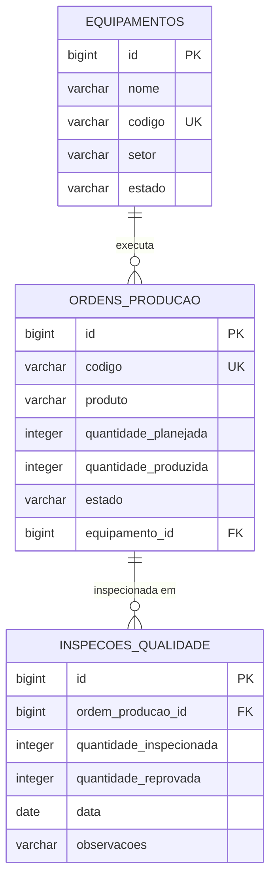

# Modelo de domínio

> No mínimo **3 entidades** e pelo menos **um relacionamento**.

## Entidades

Uma tabela por entidade. A coluna **Regra** é o que vira `NOT NULL`, `UNIQUE` ou validação no DTO.

### Equipamento

Máquina ou equipamento utilizado nas linhas de produção da indústria.

| Atributo | Tipo Java | Coluna | Obrigatório | Regra |
|---|---|---|---|---|
| `id` | `Long` | `id` | sim | Gerado pelo banco (PK) |
| `nome` | `String` | `nome` | sim | Até 255 caracteres |
| `codigo` | `String` | `codigo` | sim | Até 20 caracteres, identificador único (`UNIQUE`) |
| `setor` | `String` | `setor` | sim | Até 100 caracteres (ex: Usinagem, Montagem) |
| `estado` | `EstadoEquipamento` (Enum) | `estado` | sim | Valores: `ATIVO`, `EM_MANUTENCAO`, `MANUTENCAO_PENDENTE`, `INATIVO` |

### OrdemProducao

Ordem de fabricação de itens vinculada a um equipamento específico.

| Atributo | Tipo Java | Coluna | Obrigatório | Regra |
|---|---|---|---|---|
| `id` | `Long` | `id` | sim | Gerado pelo banco (PK) |
| `codigo` | `String` | `codigo` | sim | Identificador único (`UNIQUE`, ex: "OP-1001") |
| `produto` | `String` | `produto` | sim | Até 150 caracteres |
| `quantidadePlanejada` | `Integer` | `quantidade_planejada` | sim | Número inteiro maior que zero |
| `quantidadeProduzida` | `Integer` | `quantidade_produzida` | sim | Não negativo; quantidade efetivamente finalizada |
| `estado` | `EstadoOrdemProducao` (Enum) | `estado` | sim | Valores: `CRIADA`, `EM_ANDAMENTO`, `SUSPENSA`, `CONCLUIDA` |
| `equipamento` | `Equipamento` | `equipamento_id` | sim | Chave estrangeira que referencia `equipamentos(id)` |

### InspecaoQualidade

Registro da checagem e amostragem de qualidade das peças produzidas em uma ordem.

| Atributo | Tipo Java | Coluna | Obrigatório | Regra |
|---|---|---|---|---|
| `id` | `Long` | `id` | sim | Gerado pelo banco (PK) |
| `ordemProducao` | `OrdemProducao` | `ordem_producao_id` | sim | Chave estrangeira que referencia `ordens_producao(id)` |
| `quantidadeInspecionada` | `Integer` | `quantidade_inspecionada` | sim | Maior que zero; não pode superar `quantidadeProduzida` da ordem (R2) |
| `quantidadeReprovada` | `Integer` | `quantidade_reprovada` | sim | Não negativo; se > 10%, suspende a OP e altera estado do equipamento (R3) |
| `data` | `LocalDate` | `data` | sim | Data do registro da inspeção |
| `observacoes` | `String` | `observacoes` | não | Até 255 caracteres |

## Relacionamentos

| De | Para | Tipo | No banco | No código |
|---|---|---|---|---|
| OrdemProducao | Equipamento | muitos para um | `ordens_producao.equipamento_id` referencia `equipamentos(id)` | `@ManyToOne` em `OrdemProducao` |
| InspecaoQualidade | OrdemProducao | muitos para um | `inspecoes_qualidade.ordem_producao_id` referencia `ordens_producao(id)` | `@ManyToOne` em `InspecaoQualidade` |

## Diagrama ER

Como ler: `||--o{` é "um para muitos". Um equipamento pode ter várias ordens de produção, e cada ordem pertence a um único equipamento. Uma ordem de produção pode ter várias inspeções de qualidade, e cada inspeção pertence a uma única ordem.

## Migrations

Todas existem em `src/main/resources/db/migration`, uma tabela por arquivo. A ordem importa: a tabela referenciada nasce antes da que referencia.

| Versão | Arquivo | O que cria |
|---|---|---|
| V1 | `V1__criar_tabela_equipamentos.sql` | Tabela `equipamentos` |
| V2 | `V2__criar_tabela_ordens_producao.sql` | Tabela `ordens_producao`, com a chave estrangeira `equipamento_id` |
| V3 | `V3__criar_tabela_inspecoes_qualidade.sql` | Tabela `inspecoes_qualidade`, com a chave estrangeira `ordem_producao_id` |